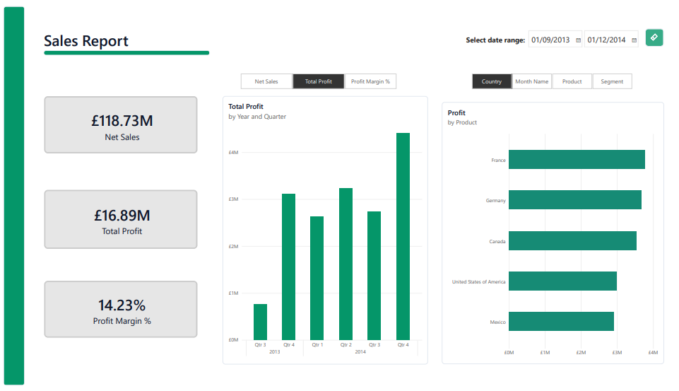

# Dynamic Power BI Report with Field Parameters | DIO Lab

### My final project of the DIO Power BI Bootcamp! 🎉

And just like that... I've reached the **very last challenge of my DIO Power BI Bootcamp!** 🤩

For this project, the task was to take a report we'd previously created and make it more interactive using **field parameters**.

The brief asked us to create at least two dynamic visuals: one based on categories and another based on financial measures.

But there was another important requirement: we needed to think about how we would present the report to a client.

So rather than simply adding two charts, I wanted to create a page that would tell a story about the business's financial performance.

## My final report

  

*My completed interactive Power BI report, built using Microsoft's Financial Sample dataset.*

## Starting with the bigger picture

I decided to organise the report around three questions:

**How is the business performing overall?**

**How has its financial performance changed over time?**

**And which parts of the business are contributing to those results?**

That became the starting point for my design.

## The financial overview

I included three KPI cards:

- **Net Sales:** £118.73M
- **Total Profit:** £16.89M
- **Profit Margin:** 14.23%

These provide a quick overview before the user starts exploring the data.

I wanted someone opening the report to understand the main financial figures immediately.

## First field parameter: financial measures

For the quarterly chart, I created a parameter allowing users to switch between:

- Net Sales
- Total Profit
- Profit Margin %

This means the same chart can be used to investigate different aspects of financial performance.

Rather than creating three separate visuals, I could let the user choose what they wanted to analyse.

I particularly liked discovering how field parameters can make a report more flexible without adding unnecessary visual clutter.

## Second field parameter: categories

For the horizontal bar chart, I created another parameter allowing users to switch between:

- Country
- Month Name
- Product
- Segment

This allows the user to explore the selected financial results across different business categories.

One chart, four different perspectives!

I found this particularly interesting because different users might want to investigate different parts of the business.

Someone might be interested in country performance, while someone else might want to understand which products or business segments are contributing most to profit.

With field parameters, the report can accommodate those different questions.

## Experimenting with conditional formatting

While testing the Segment view, I wanted to highlight something important.

The Enterprise segment was making a loss despite generating substantial sales.

So I applied conditional formatting to highlight its negative profit bar in orange, while keeping the positive values green.

I then started exploring whether I could create a dynamic colour gradient that would automatically adapt to all four category selections.

And that's where things became a little more complicated! 😂

The solution required more advanced DAX than I was comfortable implementing independently at this stage.

So I decided to keep the conditional formatting I'd already achieved and add the more advanced version to my list of future improvements.

I think this was an important part of the learning process too: recognising what I can do now and what I still need to develop.

## Keeping the design consistent

Because this project built on my previous Power BI report, I wanted the new page to maintain the same visual identity.

I kept the green, white and grey colour scheme, with a simple layout:

- Financial KPIs on the left
- A quarterly performance chart in the centre
- A category comparison chart on the right
- Parameter selectors above the charts
- A date-range slicer at the top

I wanted the page to feel like a finished report that someone could actually use, rather than a collection of exercises.

## One final troubleshooting adventure!

Just when I thought everything was finished, I exported the report to PDF...

And discovered that the dashboard was occupying only a small part of a much larger page! 😂

I investigated the canvas settings and the report's page dimensions, eventually getting the PDF export to display correctly.

Another reminder that finishing a dashboard doesn't necessarily mean the troubleshooting is finished!

## What I would improve next time

### 1. Dynamic chart titles

One thing I noticed is that the category chart's subtitle doesn't automatically change when I switch between Country, Product, Month Name and Segment.

I'd like to learn how to make chart titles respond to field parameter selections, so users always know exactly what they're looking at.

### 2. More advanced conditional formatting

I'd like to revisit the idea of creating dynamic colour gradients across different categories.

This would be a useful future DAX exercise.

### 3. Dynamic storytelling

The current report provides a clear route from the overall financial picture to more detailed analysis.

In a future version, I'd like to add written insights that change according to the user's selections.

For example, highlighting the most profitable segment or identifying areas where sales are high but profitability is low.

### 4. More user testing

I'd like to test future dashboards with people who haven't built them.

Can they understand the report without an explanation? Do they know what the buttons do? Can they find the information they need?

These are questions I want to keep exploring as I develop my Power BI skills.

## What I learned

This project gave me practical experience with:

- Creating and using Power BI field parameters
- Switching dynamically between financial measures
- Switching dynamically between business categories
- Designing interactive charts
- Building KPI cards
- Working with date hierarchies
- Applying conditional formatting
- Maintaining visual consistency
- Thinking about financial storytelling
- Troubleshooting report export issues

But my biggest takeaway was that **a report doesn't just have to show information. It can give users the freedom to investigate the questions that matter to them.**

And I think that's what made field parameters such an interesting feature to learn.

## And that's a wrap! 🎉

This is officially my final project of the DIO Power BI Bootcamp!

Looking back at everything I've worked on, it's amazing how much there was to learn.

From transforming data in Power Query and understanding dimensional modelling to creating DAX measures, building dashboards, improving user experience and now creating dynamic reports.

There were plenty of challenges along the way, and definitely a few moments when I had no idea why something wasn't working! 😂

But every challenge gave me another opportunity to investigate, experiment and learn something new.

And if there's one thing I've discovered during this career transition, it's that **I genuinely enjoy figuring out how things work and finding ways to make them work better.**

The bootcamp might be finished, but my learning certainly isn't! 💚

---

## Project files

- `dynamic_report_DIOlab.pbix` — Interactive Power BI report with field parameters.
- `dynamic_report_DIOlab.pdf` — PDF export of the completed report.
- `dynamic_report_DIOlab.PNG` — Screenshot of the final dashboard.

*Created as part of the DIO Power BI Bootcamp using Microsoft's Financial Sample dataset.*

*Report design, field parameter implementation and troubleshooting completed as an independent learning project.*
